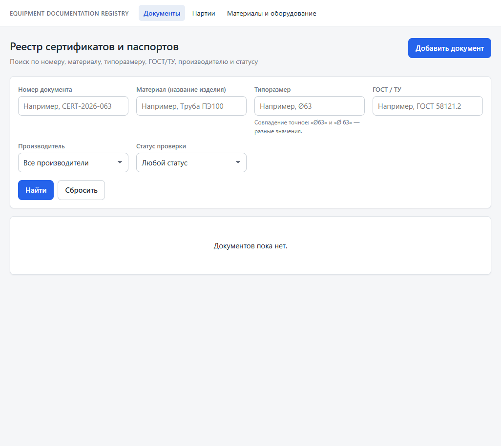
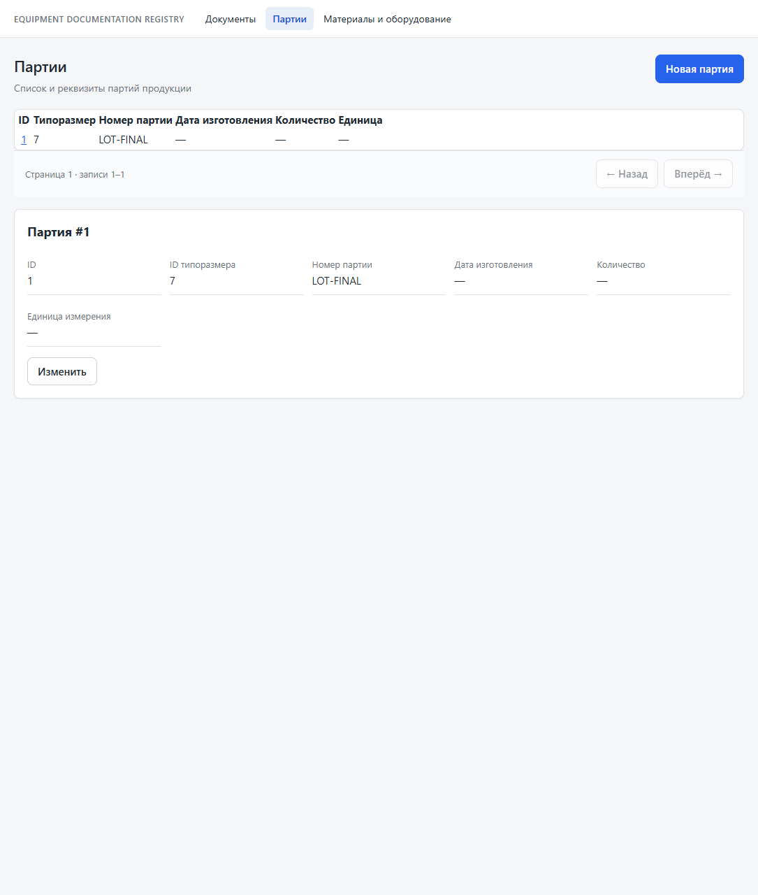

# Equipment Documentation Registry

Локальный реестр паспортов, сертификатов и сопроводительных документов на материалы и оборудование. Храните документы и сведения о партиях на своём Windows компьютере.

**[Скачать для Windows](https://github.com/shahove93/EquipmentDocumentationRegistry/releases/latest)** · [Инструкция по установке](docs/installation/windows.md)

## Возможности

- Реестр производителей, изделий и типоразмеров, типов документов и выдавших их организаций.
- Карточки документов с реквизитами, PDF/JPEG/PNG вложениями, статусом проверки и историей.
- Поиск по материалу, стандарту, размеру, производителю, номеру и статусу; привязка документов к типоразмерам.
- Учёт партий: просмотр, создание и редактирование.

Приложение работает локально для одного пользователя на одном компьютере. Учётных записей, аутентификации и облачной синхронизации нет; доступ к Windows-профилю означает доступ к данным. Не публикуйте API в интернете или локальной сети. Связь документов с изделиями и партиями пока не реализована.

## Интерфейс

Снимок списка документов показывает пустой тестовый реестр; реальные документы не использовались. На снимке партий — одна демонстрационная запись LOT-FINAL с синтетическими данными.

| Документы | Партии |
| --- | --- |
|  |  |

## Технологии

FastAPI, SQLAlchemy, Alembic и PostgreSQL; React, TypeScript и Vite. Установщик Windows включает локальные компоненты приложения и базу данных.

## Документация

- [Установка и работа в Windows](docs/installation/windows.md)
- [Разработка и проверки в WSL2](docs/development.md)
- [Индекс архитектурных решений (ADR)](docs/adr/README.md)
- [Состояние и проверенные сведения о проекте](docs/PROJECT_STATUS.md)
- [Участие в разработке](CONTRIBUTING.md)
